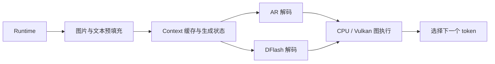

# 运行时模块

公开 API 位于 `include/hunyuan_ocr/runtime.h`，`src/runtime.cpp` 负责参数检查、图片加载、调用 Engine 和构造结果。CLI 通过公开 API 调用运行时。

## 推理流程

`Engine` 的接口和资源成员集中在 `src/internal/engine.h`。实现按职责划分：

| 文件 | 职责 |
| --- | --- |
| `engine.cpp` | 模型与 tokenizer 加载、精度选项、Vulkan 资源建立和释放、文本解码 |
| `prefill.cpp` | Vision 执行、文本 embedding、位置编码及首次 Decoder 执行 |
| `decode_ar.cpp` | AR 生成循环、停止条件、流式回调；按配置分派 DFlash |
| `decode_dflash.cpp` | 草稿生成、目标验证、接受 token 和缓存裁剪 |
| `text_runtime_cpu.cpp` | CPU embedding、Decoder、Draft 和 LM Head 图执行 |
| `text_runtime_vulkan.cpp` | Vulkan 图输入、缓存提取、命令提交及必要的数据下载 |
| `kv_cache_vk_allocator.{h,cpp}` | KV 大缓冲区的分级复用与空闲回收 |
| `sampling.{h,cpp}` | 采样配置、随机数、重复惩罚、greedy/top-k/top-p 选择 |
| `runtime_utils.h` | 内部计时与 Decoder 到 LM Head 的形状转换 |

`text_runtime.h` 声明图执行函数；解码循环决定调用顺序和停止状态，图执行函数负责输入、输出和缓存更新。Vulkan 实现与分配器使用 `NCNN_VULKAN` 条件编译，CPU 构建不依赖 Vulkan 类型。

## 状态与资源

`Runtime::Impl` 持有 Engine，Engine 持有模型网络和 Vulkan 分配器。`Context` 保存一次推理的目标/草稿 KV、位置、token 历史和停止状态。`Context::clone()` 保持 ncnn 张量的引用计数复制语义。

Vulkan 执行先提交并等待命令完成，再替换缓存并回收空闲缓冲区。Engine 释放资源时先清理网络，再释放分配器。修改这些顺序时，需要单独验证缓存和分配器的生命周期。

本次拆分保留公开 API、生成算法、精度策略和资源释放顺序。后续改动的验证入口见 [回归验证说明](validation.md)。
